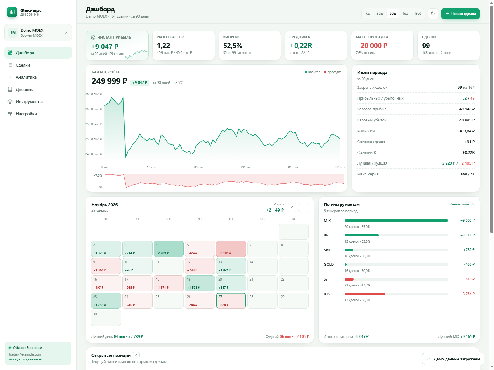
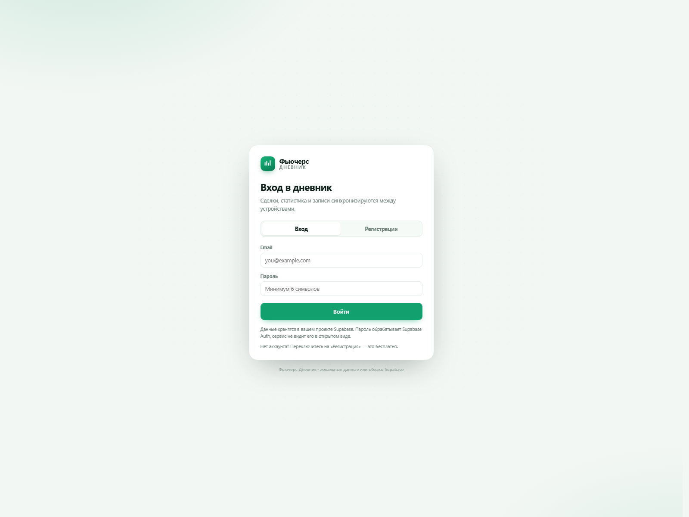
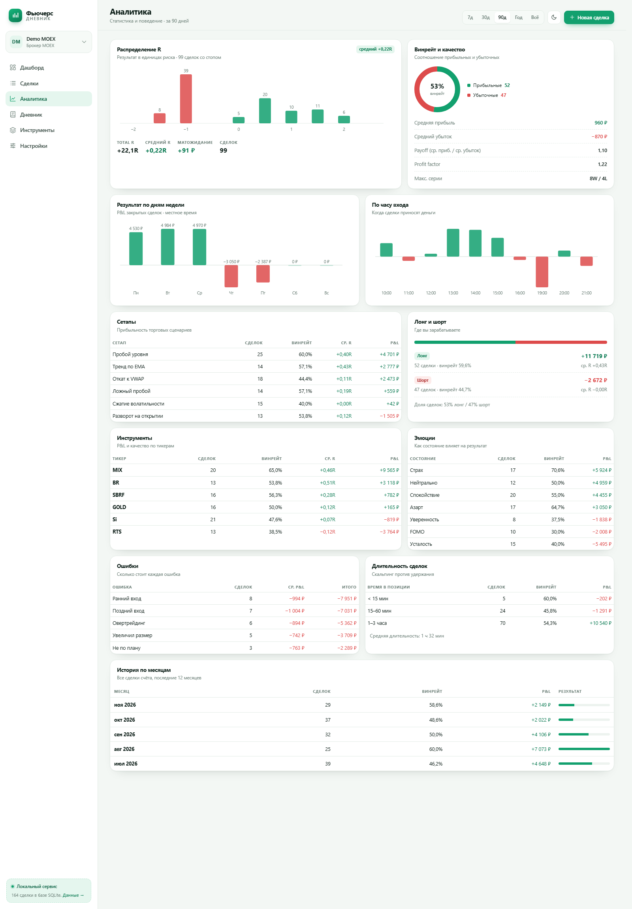
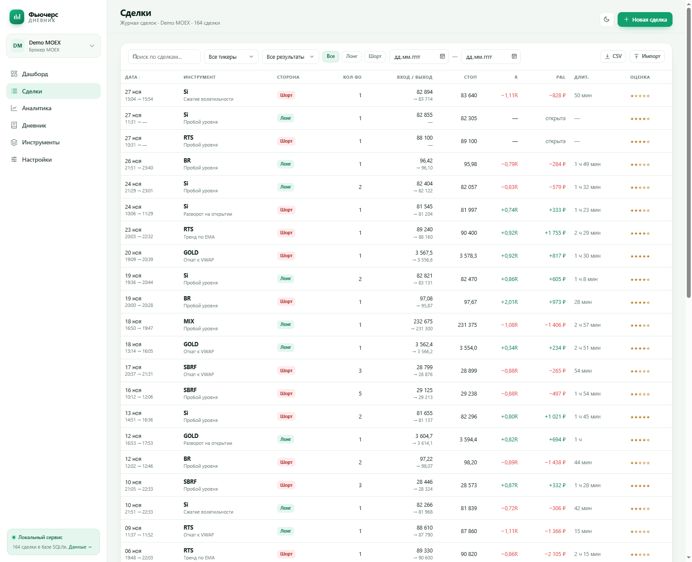
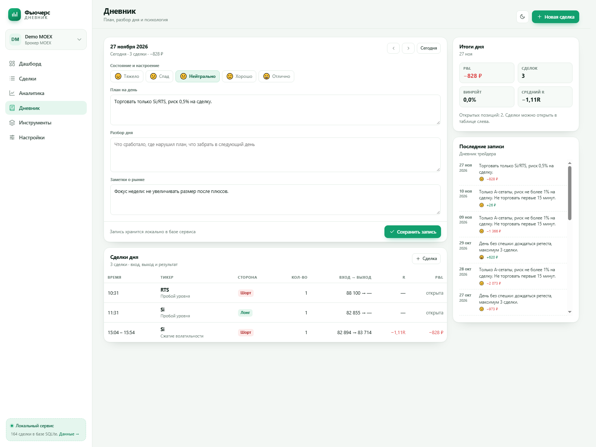
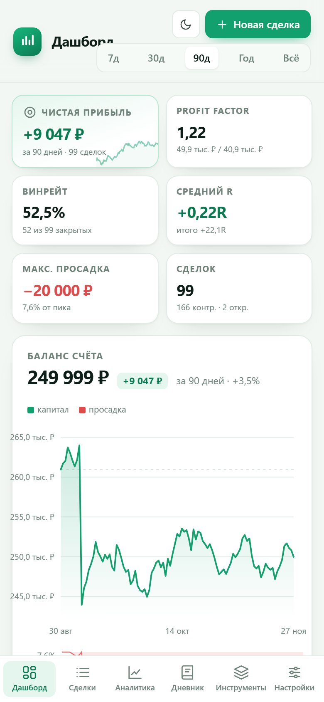
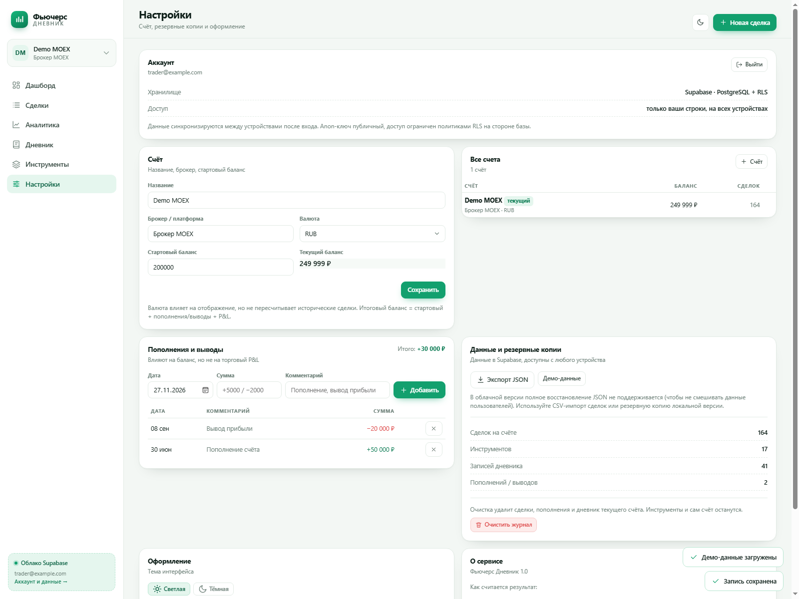

# Фьючерс Дневник — MOEX

Дневник трейдера фьючерсами **Московской биржи**: сделки, P&L в рублях, R-мультипликаторы, кривая капитала, календарь результатов, сетапы, ошибки и записи по дням.

Рынок: MOEX (Fortes), валюта счетов — рубли. Справочник уже заполнен фьючерсами Si, RTS, MIX, BR, NG, GOLD, CNY, Eu, GAZR, SBRF и другими.

Два режима на выбор:

| | Локальный | Облачный |
|---|---|---|
| Где работает | Node.js на вашем компьютере | GitHub Pages (статика) |
| Данные | SQLite `data/journal.db` | Supabase Postgres |
| Пользователи | один | многопользовательский, вход по email |
| Стоимость | 0 ₽ | 0 ₽ на free-тарифах Supabase и GitHub Pages |
| Кому подходит | личный журнал без интернета | доступ с разных устройств, друзья/ученики |



## Возможности

- **Дашборд** — баланс счёта, чистая прибыль, profit factor, винрейт, средний R, максимальная просадка, кривая капитала с просадкой, календарь P&L по дням, разбивка по инструментам, открытые позиции.
- **Сделки** — фильтры по тикеру, стороне, результату и датам, сортировка, пагинация, экспорт и импорт CSV, редактирование по клику.
- **Аналитика** — распределение R, винрейт и payoff, результат по дням недели и часам входа, сетапы, лонг/шорт, эмоции, ошибки, длительность удержания, история по месяцам.
- **Дневник** — настроение, план на день, разбор, заметки о рынке; рядом сделки дня и лента последних записей.
- **Инструменты** — справочник фьючерсов MOEX (Si, RTS, MIX, BR, NG, GOLD, CNY, Eu, GAZR, SBRF и другие): стоимость пункта, шаг цены, гарантийное обеспечение, биржевая комиссия.
- **Счета** — несколько торговых счетов, стартовый баланс, пополнения и выводы, которые не искажают торговый P&L.
- **Данные** — экспорт JSON и CSV, демо-журнал, очистка; локально — полное восстановление JSON.
- **Оформление** — светлая и тёмная темы, адаптив под телефон.

## Локальный запуск

Нужен **Node.js 24+** (встроенный `node:sqlite`), внешних зависимостей нет.

```bash
cd futures-journal
npm start
# или: node server.js
```

На Windows можно дважды кликнуть `start.cmd`.

Откройте <http://127.0.0.1:3000>. При первом запуске создаётся `data/journal.db` и загружается демо-журнал MOEX на пять месяцев (164 сделки, рублёвый счёт 200 000 ₽). Начать с пустой базы: `SEED_DEMO=0 node server.js`.

Если `config.js` уже содержит ключи Supabase, по умолчанию откроется облачный вход. Для локальной SQLite-версии используйте `http://127.0.0.1:3000/?local=1`.

## Облачная версия: Supabase + GitHub Pages

Сервер не нужен: интерфейс — статические файлы на GitHub Pages, вход и база — бесплатный проект Supabase. Каждый пользователь видит только свои сделки — это обеспечивают RLS-политики Postgres.

```
GitHub Pages (HTML/CSS/JS)
        │  HTTPS + anon key + JWT
        ▼
Supabase: Auth (email/пароль) + Postgres (RLS)
```

### Бесплатные лимиты

- Supabase Free: 500 МБ базы, 50 000 MAU, без ограничения API-запросов, 5 ГБ трафика. Проект **засыпает после недели без запросов** — данные сохраняются, проект включается в панели Supabase. [Тарифы](https://supabase.com/pricing)
- GitHub Pages: статический хостинг бесплатно для публичных репозиториев, без карты.

500 МБ хватает на сотни тысяч сделок: скриншоты хранятся ссылками, а не файлами.

### Настройка за пять шагов

1. Создайте бесплатный проект на [supabase.com](https://supabase.com).
2. Откройте **SQL Editor** и выполните целиком файл [`supabase/schema.sql`](supabase/schema.sql). Он создаёт таблицы, индексы, RLS-политики и права.
3. В **Authentication → Providers → Email**:
   - включите провайдер **Email** (по умолчанию он может быть выключен — тогда вход не работает);
   - для быстрого старта отключите **Confirm email** (иначе нужно настроить SMTP);
   - для продакшена оставьте подтверждение и укажите **Site URL** и **Redirect URLs** вашего сайта на Pages, например `https://username.github.io/futures-journal/`.
4. В **Project Settings → API** скопируйте **Project URL** и **anon public key** в файл [`public/js/config.js`](public/js/config.js):

```js
window.FD_CONFIG = {
  supabaseUrl: 'https://xxxxxxxx.supabase.co',
  supabaseAnonKey: 'eyJhbGciOi...',
};
```

5. Запушьте проект в GitHub. В репозитории откройте **Settings → Pages → Build and deployment → Source: GitHub Actions**. Workflow [`.github/workflows/pages.yml`](.github/workflows/pages.yml) сам опубликует папку `public` при пуше в `main` (он также пытается включить Pages автоматически).

Пошаговая инструкция для GitHub Desktop, Git и загрузки через браузер — в [DEPLOY.md](DEPLOY.md).

Репозиторий может быть публичным: в нём нет данных и секретов, только anon-ключ, доступ к строкам которого закрыт RLS. Если ваша ветка называется `master`, поправьте `branches` в workflow.

Сайт откроется по адресу `https://<username>.github.io/<repo>/`. Зарегистрируйтесь — сервис создаст счёт и справочник инструментов, дальше можно вносить сделки или загрузить демо в настройках.

Если на экране входа появилось красное сообщение «Email-вход отключён», значит провайдер Email выключен: включите его в Supabase → Authentication → Providers → Email и обновите страницу.

### Важно про безопасность

- **Anon-ключ не секретный** — его можно держать в статическом фронтенде. Доступ к строкам ограничен RLS: политики сверяют `user_id = auth.uid()` и проверяют, что сделка ссылается на счёт того же пользователя.
- **Никогда не вставляйте `service_role` ключ** во фронтенд: он обходит RLS.
- Пароли обрабатывает Supabase Auth; приложение их не хранит.
- Сброс пароля и управление пользователями — в панели Supabase (Authentication → Users). Отдельного экрана сброса в интерфейсе пока нет.

### Ограничения облачной версии

- Полное восстановление JSON отключено (чтобы не смешивать данные пользователей) — используйте CSV-импорт или локальную версию.
- Нет realtime-синхронизации: данные обновляются при загрузке страницы и после действий.
- Free-проект Supabase засыпает после 7 дней простоя; разбудите его в панели, данные останутся.
- Если включено подтверждение email, письма на free-тарифе Supabase имеют лимиты; для стабильной отправки подключите свой SMTP.

### Локальная проверка облачного режима

В репозитории есть мок Supabase и браузерный e2e (Windows + Edge):

```bash
node scripts/mock-supabase.js      # мок Auth/PostgREST на :3010
node scripts/cloud-e2e.mjs         # регистрация, демо, выход, скриншоты
```

Мок нужен только для разработки: в нём нет RLS и настоящих паролей.

## Скриншоты

| | |
|---|---|
|  |  |
|  |  |
|  |  |

## Спецификации MOEX

В справочнике 17 контрактов MOEX: Si, RTS, MIX, MXI, BR, NG, GOLD, SILV, PLT, CNY, Eu, GAZR, SBRF, LKOH, ROSN, VTBR, MMI. Значения стоимости пункта, шага цены и ГО взяты из ISS MOEX на 27.11.2026; комиссия — биржевой сбор (брокерскую добавляйте вручную).

`стоимость пункта = стоимость шага цены / шаг цены`. Для RTS, BR, NG и GOLD стоимость шага зависит от курса USD/RUB, поэтому со временем её нужно обновлять в **Инструментах**. Сделки хранят снимок спецификации, так что старые расчёты не изменятся.

## Как считается результат

Для каждой сделки сохраняется снимок спецификации инструмента на момент ввода, поэтому изменения справочника не переписывают историю.

- `P&L = направление × (выход − вход) × контракты × стоимость пункта − комиссии + фандинг`
- `риск = |вход − стоп| × контракты × стоимость пункта`
- `R = P&L / риск`
- `баланс = стартовый баланс + пополнения − выводы + P&L закрытых сделок`
- просадка считается от пика капитала внутри выбранного периода

Сделка без цены и времени выхода считается открытой и не попадает в статистику закрытых.

## Импорт и экспорт

**CSV** (`Сделки → Импорт`) понимает разделитель `;` или `,`, заголовки на русском или английском, десятичную запятую и кодировку Windows-1251:

```csv
date;exit_time;symbol;side;qty;entry;exit;stop;target;fees;setup;tags;emotion;mistakes;rating;notes
2026-11-24 10:35;2026-11-24 11:10;Si;long;1;82525;82600;82300;82800;7.62;Откат к VWAP;A+;Спокойствие;;5;Вход после ретеста
```

Если время не указано, вход ставится на 10:30, выход — на час позже. Шаблон можно скачать в окне импорта. Неизвестные тикеры пропускаются с указанием строки.

**JSON** (`Настройки → Данные`) — полная резервная копия. В локальной версии её можно восстановить, в облачной — только выгрузить.

## Структура проекта

```
futures-journal/
├── server.js                 # локальный HTTP-сервер + SQLite, без зависимостей
├── public/
│   ├── index.html            # оболочка, SVG-иконки
│   ├── analytics.js          # чистые расчёты: P&L, R, equity, периоды
│   ├── css/styles.css        # светлая/тёмная тема, адаптив, экран входа
│   └── js/
│       ├── config.js         # URL и anon key Supabase
│       ├── cloud.js          # Auth + PostgREST, bootstrap, демо
│       ├── auth.js           # вход/регистрация/подсказка по настройке
│       ├── app.js            # роутер, гейт авторизации, sidebar
│       ├── api.js            # локальный API или облачный адаптер
│       ├── store.js, format.js, components.js, charts.js, csv.js, trade-form.js
│       └── pages/            # dashboard, trades, analytics, journal, instruments, settings
├── supabase/schema.sql       # таблицы, RLS, права — выполнить в SQL Editor
├── .github/workflows/pages.yml
├── scripts/                  # мок Supabase и облачный e2e
├── test/                     # node:test — расчёты, CSV, API, демо
└── data/journal.db           # создаётся локальным сервером
```

## Тесты

```bash
npm test
# или: node --test
```

31 тест: P&L/R/просадка, статистика, R-гистограмма, периоды, CSV с русскими заголовками и запятыми, валидация API, восстановление копии, статика, демо-генератор, RLS-схема.

Облачный сценарий в браузере (Windows + Edge): `npm run test:cloud` — поднимает мок Supabase, регистрирует пользователя, загружает демо и проверяет выход.

## API

**Локально** — собственный REST на Node.js:

| Метод | Путь | Назначение |
|---|---|---|
| GET | `/api/data` | счета, сделки, инструменты, дневник, пополнения |
| POST/PUT/DELETE | `/api/{accounts\|cashflows\|instruments\|trades}` | CRUD |
| PUT | `/api/journal` | запись по дате |
| POST | `/api/trades/bulk` | пакетный импорт |
| POST | `/api/demo` / DELETE `/api/data` / POST `/api/restore` | демо, очистка, восстановление |

**В облаке** — Supabase PostgREST: `/rest/v1/{table}` с JWT пользователя; доступ ограничен RLS. Auth — `/auth/v1/*`.

## Замечания

- Сервис не отправляет данные в интернет, кроме облачного режима, где они идут в ваш Supabase.
- Справочник уже настроен на MOEX: 17 контрактов, стоимость пункта и шаг цены взяты из ISS MOEX на 27.11.2026. Комиссия в справочнике — биржевой сбор; брокерскую добавьте вручную. Спецификации можно менять — старые сделки хранят свои значения.
- Демо-журнал можно пересоздать в настройках. Для реальной торговли очистите его и заведите свой счёт в рублях.
- Это личный журнал, а не торговый терминал: брокерского подключения и выставления заявок нет.
